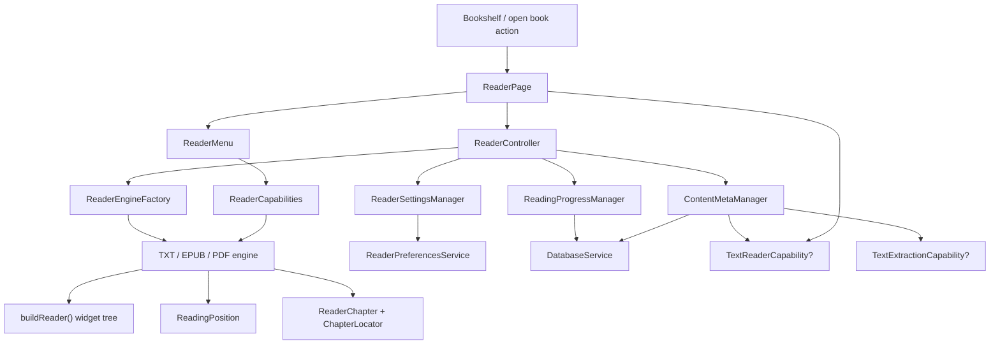

# Reader Architecture Map

This document describes the current reader architecture after the refactor phases that introduced capability-based engines, unified position models, typed chapter navigation, and optional engine capabilities.

## 1. Reader Architecture Overview

The reader is organized as a small layered system:

1. UI layer
   - `ReaderPage` creates the reader session and binds gestures, the One Paper chrome (floating dock that grows in-place into Chapters/Settings sheets), overlays, and menu UI.
   - `ReaderMenu` gates visible controls using `ReaderCapabilities`.
   - `ChapterListWidget` renders the table of contents from typed `ReaderChapter` data.

2. Session controller layer
   - `ReaderController` is the orchestration point for one open book.
   - It owns the active `ReaderEngine` and delegates specialized concerns to managers.

3. Manager layer
   - `ReadingProgressManager` owns progress polling, save cadence, and restore.
   - `ContentMetaManager` owns chapters, current chapter sync, bookmarks, highlights, and snippet backfill.
   - `ReaderSettingsManager` owns reader typography/theme settings and persistence.

4. Engine contract layer
   - `ReaderEngine` defines the shared engine lifecycle and navigation contract.
   - Optional capability interfaces expose text-specific, snippet, and page-metrics behavior only where it is real.

5. Engine implementation layer
   - `TxtReaderEngine`
   - `EpubReaderEngine`
   - `PdfReaderEngine`

6. Persistence / infrastructure layer
   - `DatabaseService` stores reading positions, progress, bookmarks, and highlights.
   - `ReaderPreferencesService` stores reader UI preferences.
   - `BookSourceAccess` provides file access and source normalization.

### Data Flow Summary

`Book -> ReaderController -> ReaderEngine.initialize() -> chapters + reader widget -> ReadingProgressManager / ContentMetaManager -> DatabaseService / preferences`

The UI does not talk to storage directly. The reader page talks to the controller, the controller talks to managers and the engine, and managers talk to persistence.

## 2. Component Interaction Diagram

## 3. ReaderEngine Contract

Current core `ReaderEngine` responsibilities live in [`lib/modules/reader/reader_engine/reader_engine.dart`](./lib/modules/reader/reader_engine/reader_engine.dart).

### Core responsibilities

- `initialize()`
  - Load the source book, parse it, and prepare internal engine state.
- `buildReader(BuildContext context)`
  - Return the widget subtree that renders the book content.
- `goToPosition(ReadingPosition position)`
  - Restore or jump to a unified reading position.
  - This is the current restore entry point; there is no separate `restorePosition()` method.
- `getCurrentPosition()`
  - Return the current logical reading location.
- `setConfig(ReaderConfig config)`
  - Apply engine-supported reader appearance settings.
- `getProgress()`
  - Return normalized reading progress from `0.0` to `1.0`.
- `seekToProgress(double progress)`
  - Jump to a normalized progress position.
- `getChapters()`
  - Return typed chapter data as `List<ReaderChapter>`.
- `goToChapter(ChapterLocator locator)`
  - Navigate using a typed chapter locator.
- `nextPage()` / `previousPage()`
  - Perform the engine's forward/backward navigation step.
- `hasBottomBar`
  - Indicates whether the engine renders its own bottom information bar.
- `dispose()`
  - Release controller/listener/file resources.

### Contract boundaries

The core contract is now intentionally narrow:
- text highlighting is not part of the base contract
- snippet extraction is not part of the base contract
- page metrics are not part of the base contract

Those behaviors are exposed only through optional capability interfaces.

## 4. Optional Capability Interfaces

Optional capabilities also live in [`lib/modules/reader/reader_engine/reader_engine.dart`](./lib/modules/reader/reader_engine/reader_engine.dart).

### `TextReaderCapability`

Purpose:
- bind text interaction callbacks
- push render highlights into an engine
- read paragraph text for anchor healing and selection workflows

Methods:
- `configureInteractions(...)`
- `setHighlights(List<Highlight>)`
- `getParagraphText(int paragraphIndex)`

Implemented by:
- TXT only

Why:
- These APIs are meaningful for paragraph-based text rendering, but not for the current EPUB/PDF implementations.

### `TextExtractionCapability`

Purpose:
- extract snippets from the current location
- backfill bookmark text from a stored `ReadingPosition`

Methods:
- `getSnippet()`
- `getTextAtPosition(ReadingPosition position)`

Implemented by:
- TXT only

Why:
- TXT can resolve paragraph-based text reliably.
- EPUB/PDF do not currently provide trustworthy snippet extraction in this architecture.

### `PageMetricsCapability`

Purpose:
- expose page count and current page index only where those values are real and meaningful

Methods:
- `getPageCount()`
- `getCurrentPageIndex()`

Implemented by:
- TXT
- PDF

Not implemented by:
- EPUB

Why:
- TXT has pagination estimation logic.
- PDF has true page numbers.
- EPUB's previous `0 / 0` values were placeholders, so EPUB is intentionally outside this interface.

## 5. Key Models

### `ReadingPosition`

Unified position model used for save/restore and current-location tracking.

Fields:
- `paragraphIndex` (+ optional `paragraphLeadingEdge` / `paragraphTrailingEdge` viewport refinement)
- Optional `textOffset` (UTF-16 in the exact displayed paragraph),
  `textViewportOffset` (normalized reading-line top), `layoutIdentity`, and
  `anchorVersion` (1). Added by item 05 for TXT/EPUB reflow restoration.
- `pageNumber`
- `cfi` (legacy EPUB field — read for backward compatibility, no longer written)
- `chapterIndex`

Usage:
- TXT uses `paragraphIndex` + viewport edges + optional text anchor; the runtime
  snapshot remains a `TxtReadingPosition` for existing consumers.
- PDF uses `pageNumber`
- EPUB uses `paragraphIndex` + viewport edges (2026-07 self-hosted renderer;
  pre-rework rows also carried a `cfi`, which restore ignores in favor of the
  dual-written `paragraphIndex`)

`ReadingProgressManager` serializes and restores this model through `DatabaseService`.

TXT/EPUB mode and reflow restoration (05, 2026-10-22):

- `ReaderPage` keeps `SmoothPageReader` mounted in every mode; `enabled` only
  controls horizontal tap handling. A mode change cancels an undispatched old
  capture/animation. A stable keyed live-reader slot also prevents animation
  start/end from remounting the engine body. Mode-only changes preserve the live
  scrollable and paint. The live body has its own repaint boundary so translating
  it does not repeatedly paint paragraph text. Snapshot resolution and transition
  timing are unchanged.
- Engines own the last committed viewport snapshot and the accepted restore.
  Text widgets register only mounted geometry handles in `TextLayoutAnchors`;
  no second controller/widget position owner or whole-book layout pass is added.
- Anchors use the actual `RenderEditable` line/caret geometry, including the
  actual font, heading style, padding and text scaling. Capturing the last
  committed frame avoids sampling already-rescaled text with old viewport edges.
  Build-phase progress reads never query render geometry, and detached text
  handles are ignored; measurement belongs to commands/committed-frame callbacks.
- Layout identity includes format, platform, locale/direction, viewport size,
  typography and scaled body/heading sizes. Matching layouts retain exact edges;
  changed layouts restore the original character on the first reading line.
  The accepted character survives repeated reflows until navigation/scrolling
  changes the reading location. Boundary correction must finish before the
  restored pixels are committed. When a short book fits entirely in the new
  viewport, the still-visible retained paragraph remains the logical position
  (including progress/chapter selection), even below the top of the viewport.
  Scrolling or a new drag releases that exception. A partially visible final
  text line is a valid fallback when no fully visible line remains in its row.
- Reflow targets stay authoritative for saves until layout commits. A paint-only
  gate suppresses intermediate paragraph-start frames; new drags can supersede
  restoration. This can briefly hide text during reflow and is not an animation
  optimization. Stale serials cannot overwrite newer navigation or layout.
- The JSON change is additive; unknown/invalid optional anchor fields fall back
  safely. Old records without text offsets keep legacy edge/paragraph recovery;
  their exact former text cannot be reconstructed after reflow. Existing JSON
  columns need no schema migration. Older builds ignore the new keys and may
  discard the precision when saving again. Fonts/rendering changes require
  reviewing the layout/anchor version before reusing historical geometry.
- Paragraph enumeration, highlights, chapter locators, progress percentages and
  PDF positioning remain unchanged. Image-only slots use existing geometry
  fallback; async image sizing is still tracked separately in item 10.

### `ChapterLocator`

Typed navigation payload for chapter jumps.

Fields:
- `chapterIndex`
- `pageNumber`
- `contentIndex`

Usage:
- TXT chapter navigation uses `chapterIndex` as the starting paragraph index
- PDF chapter navigation uses `pageNumber`
- EPUB chapter navigation uses `contentIndex`

### `ReaderChapter`

Typed TOC / chapter list item.

Fields:
- `title`
- `locator`
- `index`
- `isSynthetic`

Usage:
- `ReaderEngine.getChapters()` returns `List<ReaderChapter>`
- `ChapterListWidget` renders it directly
- `ContentMetaManager` uses `ReaderChapter.locator` for previous/next chapter navigation

### `ReaderCapabilities`

UI-facing capability matrix. Since P2-4 each capability is a `CapabilityLevel` (`none / limited / full`) rather than a boolean; `supportsXxx` boolean getters remain as convenience wrappers (`level != none`).

Fields:
- `typography: CapabilityLevel`
- `theme: CapabilityLevel`
- `highlights: CapabilityLevel`
- `annotations: CapabilityLevel`
- `pageAnimation: CapabilityLevel`
- `chapterNavigation: ReaderChapterNavigation` (`none / semantic / synthetic`)

Usage:
- `ReaderMenu` hides unsupported controls
- `ReaderPage` hides TOC drawer behavior for engines without chapter navigation
- managers use capabilities to decide whether highlight flows should run

## 6. Engine Responsibilities and Capability Matrix

### TXT engine

File: [`lib/modules/reader/reader_engine/txt/txt_reader.dart`](./lib/modules/reader/reader_engine/txt/txt_reader.dart)

Role:
- decode TXT bytes
- split content into paragraphs
- detect chapters from text patterns
- render paragraph list with highlights
- estimate pagination and expose page metrics

Core characteristics:
- paragraph-based reading model
- chapter detection is regex-based
- highlight rendering and anchor healing are supported
- pagination is layout-sensitive and cached by layout key

The TXT page estimate uses the selected font family and the effective size
from `TextScaler.scale(fontSize)` as part of the layout key. The estimator
measures a sample at one text style, so the scaled size identifies its input
even for nonlinear scaling. Viewport and typography changes both request an
estimate. The engine records the requested key before checking in-flight work
and publishes results only for that key. Returning from A to B to A can reuse
A's pending estimate, while a late B result cannot replace it. The estimate
feeds the page bar. Navigation and restore use viewport anchors separately.

Navigation and restore (01A/02, 2026-10-19):
- Single visible paragraphs at least one viewport high advance by 0.92 of the
  actual content viewport, including across their trailing edge. Ordinary
  paragraph selection retains its existing viewport-distance policy.
- TXT uses the public Flutter `ScrollPosition` obtained from scroll metrics for
  pixel motion. It does not pass negative alignment to `ItemScrollController`
  or import dependency internals. Adjacent turns avoid the positioned list's
  two-list `scrollTo` transition.
- Restore synchronously establishes an index anchor and applies its saved
  leading-edge pixel offset before the next paint. Pre-attachment targets stay
  in the engine and are applied once metrics become available; the initial
  uncorrected layout is hidden. `getCurrentPosition()` reports the accepted
  target until that layout commits, protecting concurrent saves.
- A mounted restore Future completes after the target frame; a pre-attachment
  request returns once accepted so initialization can proceed to mount the view.
- Navigation generations prevent superseded restore completion from replacing
  a newer target. Layout changes cancel old driven motion; teardown detaches
  the public scroll position. Same-layout backward history keeps pixel anchors.
- `ReadingPosition` JSON, paragraph enumeration, database schema, progress and
  page-count estimation are unchanged. Old index-only positions still work.
  Item 05 subsequently adds optional character anchors and stable mode switching.

TXT turn-history validity (04, 2026-10-22):
- Up to 48 completed forward turns retain both start and end viewport anchors.
  Previous reuses an anchor only when its endpoint matches the current paragraph,
  edges, scroll offset and viewport epoch within two logical pixels.
- User drag/scroll notifications invalidate history immediately; endpoint checks
  also reject unannounced external movement. Explicit navigation, font/size/mode
  changes, teardown and a replacement scroll position invalidate old records.
- A turn Future completes after the resulting frame so history records actual
  layout. Canceled, superseded, incomplete and no-op turns create no records.
  Even a boundary no-op supersedes an earlier animation and stops its motion.
- The unused forward stack is removed. Distance selection and the 300 ms vertical
  animation remain unchanged; the current engine position remains authoritative.
- No public signatures, position JSON, persistence schema, paragraph enumeration
  or page-count estimation change. Clearing history on a layout change does not
  itself provide cross-layout anchoring; item 05 adds that separately.

The shared `SmoothPageReader` waits for paint using `endOfFrame`, reserves a
turn before asynchronous snapshot capture, and falls back to one direct turn
when capture is unavailable. It no longer reads `debugNeedsPaint` in production.
Capture/animation disposal and dispatch failures release the turn reservation.
Item 08 replaces the midpoint switch with a preparation phase: the outgoing
snapshot covers the live reader, navigation runs once, and the 360 ms slide
starts only after target presentation is ready. The engine remains the sole
owner of position; cancelling presentation never rolls back accepted navigation.
The target snapshot reuses the frame already awaited after presentation readiness.
It must not request another `endOfFrame` solely for capture: from idle that
schedules an extra covered frame. Outgoing capture still awaits paint normally;
the private `frameReady` path is used only immediately after the readiness frame.
Pixel tests include a final visual update published with readiness and cancellation.

`PageTurnRequest` invalidates capture, queued navigation and image waits on
layout/mode changes, overlay opening, backgrounding, disposal or the UI deadline.
`ReaderController.nextPage/previousPage` accept an optional request; existing
callers remain source-compatible. Queue failures now reach their caller while a
separate recovery future keeps the queue usable. `currentPosition` delegates to
the engine, and `waitForPagePresentation` is the UI-facing readiness entry point.
No `ReaderEngine` navigation signature, position JSON or database schema changes.
The reader body's narrow selector includes mode and typography/color inputs as
well as `renderEpoch`: the preferences service provider alone does not subscribe
to its notifier. A programmatic preference change must update the gesture surface
and cancel old presentation even without an unrelated parent rebuild.

The additive optional `PagePresentationCapability` exposes
`waitForPagePresentation(PageTurnRequest)`. PDF waits on the existing public
`PdfPageImageProvider` for the target page; EPUB waits on mounted visible image
blocks and their existing decode cache. TXT uses its completed navigation layout
plus a committed frame. Image listeners are removed on completion/cancellation;
the capability owns neither a second position nor a second image cache.

Capture has a 350 ms deadline and navigation/readiness each have a 1500 ms
deadline, bounded by the reader's overall 3 s request. A late GPU capture is
disposed and cannot dispatch navigation; only one capture can remain pending.
Unavailable captures fall back to one direct navigation. A target-image timeout
reveals the reader's normal loading state instead of animating an unready page.
Navigation errors reach the existing localized error feedback.

The live body stays mounted throughout preparation and animation. Item 08 uses
one outgoing snapshot over the live target; item 13's rendering optimizations
remain separate, unaccepted work. See `docs/READER_TURN_FIX_08.md` for the isolated
verification scope and known body-gesture limitations.

Item 13A instrumentation is confined to a disposable diagnostic project; it
does not add a production listener or change reader contracts. Independent
comparison against the G2 commit and frame/system evidence are documented in
`docs/READER_PERFORMANCE_13A_RESULTS.md`. Full-app worst-round performance is
still outside the budget. Image-size notifications can invalidate EPUB turn
history and restoration during cancellation in both historical comparison
variants. The separate EPUB image lifecycle fix now retains completed image
data and decoded dimensions across list remounts, including bitmap eviction.
It preserves existing navigation/restoration ownership and public contracts;
see `docs/READER_EPUB_IMAGE_POSITION_FIX.md` for verification and limits.

The following item 13 rendering changes remain experimental and have not passed
overall performance acceptance.
The live body remains mounted in one repaint boundary; only that body is captured.
Snapshots retain device pixel resolution and use bilinear translation sampling.
TXT/EPUB also capture the ready target once and suppress live painting using
static opacity 0 during the slide (layout and state stay mounted). Both images
are disposed when presentation ends. The additional RGBA target is limited to
16 MiB; larger viewports or unavailable target captures retain live painting.
PDF already paints an image and uses only the outgoing capture. The legacy
hardcoded black edge gradient is removed. No screenshot downsampling,
animation-duration reduction, full-book layout cache or new dependency is added.

G1 routes ordinary horizontal touch drags from the text selection recognizer
into the reader's existing navigation callbacks. `ReaderSelectableText` uses
public `EditableText` / `TextSelectionGestureDetectorBuilder` APIs, retaining
native long-press selection, handles and vertical scrolling. `ReaderTextGestures`
provides UI routing only; position and paragraph layout ownership do not change.
See `docs/READER_GESTURE_FIX_G1.md`.
G2 moves horizontal taps into the winning text recognizer: side-zone touch
multi-taps navigate without selecting words; center single taps wait for the
double-tap window while center pointer-down immediately cancels presentation.
Mounted selection ownership and input epochs suppress navigation during selection
and invalidate delayed controls after a newer input. No reading position is
stored in this UI registry. See `docs/READER_GESTURE_FIX_G1_G2.md`.

Implements optional capabilities:
- `TextReaderCapability`
- `TextExtractionCapability`
- `PageMetricsCapability`

### EPUB engine

File: [`lib/modules/reader/reader_engine/epub/epub_reader.dart`](./lib/modules/reader/reader_engine/epub/epub_reader.dart)

Role (2026-07 self-hosted stack — no epub_view/epubx dependency):
- parse the package via `epub_package_parser.dart` (container/OPF/NCX/nav)
  and linearize chapter HTML into paragraphs in a helper isolate
  (`epub_parse_helpers.dart`); images/fonts are never eagerly decompressed
- content enumeration is **spine-primary** (2026-07, enumeration v2): every
  spine file is linearized exactly once in spine order; TOC-referenced files
  missing from the spine are appended afterwards; the flattened TOC only
  maps titles/anchors into that stream (`kEpubEnumerationVersion`). Chapter
  start indexes may be non-monotonic for TOCs listed out of spine order —
  `ContentMetaManager` scans for `max start <= current`, it does not bisect
- render paragraphs through the same `ScrollablePositionedList` +
  `HighlightableText` machinery as TXT
- map the TOC tree into typed `ReaderChapter` with an id → paragraph anchor map
- restore and persist location by absolute paragraph index; EPUB payloads
  written since the spine-primary switch carry `enumVersion` in their JSON
  (forensic marker, never consulted on restore)

Core characteristics:
- progress is paragraph based rather than page based
- chapter navigation uses `contentIndex`
- typography/theme/highlights are engine-driven (`ReaderConfig` +
  `TextReaderCapability`), like TXT
- page metrics are intentionally not exposed

Navigation and restore (03, 2026-10-22):
- Adjacent EPUB turns move 0.92 of the actual content viewport, clamped at
  document boundaries. Counting visible paragraphs is no longer used: a
  partially visible paragraph may still contain many unread screens.
- Pixel movement uses the public Flutter ScrollPosition. Tap mode jumps under
  the existing horizontal wrapper; vertical mode retains its 250 ms curve.
- Up to 48 completed turn anchors support reverse traversal, including a
  shortened boundary turn. Anchors are invalidated by gestures, explicit
  navigation, layout/image size changes, or mismatched viewport geometry.
- Index navigation and saved leading-edge offsets are applied synchronously
  before the target paint. The engine retains a pre-mount restore and reports
  that accepted target until its layout completes; Book metadata also retains
  the full position. Generations reject stale async completions.
- Chapter, bookmark and progress seeks share this immediate restore path;
  vertical progress seeks no longer use the positioned list's two-list
  animated transition. Adjacent vertical turns remain animated.
- Image extraction sends only strings through a top-level compute callback,
  avoiding capture of a live engine's unsendable scroll state.
- No public method signatures, position JSON fields, enumeration version,
  paragraph ordering, database schema or dependencies change. Item 05 adds
  cross-layout content anchoring; image layout stability (10), progress semantics (14)
  remain separate work. Item 08 adds shared target readiness and cancellation,
  described above and in `docs/READER_TURN_FIX_08.md`; item 13 remains separate.

Implements optional capabilities:
- `TextReaderCapability`
- `TextExtractionCapability`

### PDF engine

File: [`lib/modules/reader/reader_engine/pdf/pdf_reader.dart`](./lib/modules/reader/reader_engine/pdf/pdf_reader.dart)

Role:
- open PDF through `pdfx`
- restore and persist location by page number
- expose synthetic chapter entries every N pages for minimal navigation

Core characteristics:
- true page-number navigation
- no text highlights or snippets in the current architecture
- synthetic TOC only, so `chapterNavigation` is `synthetic`

Implements optional capabilities:
- `PageMetricsCapability`

### Capability matrix

| Engine | Typography | Theme | Highlights | Annotations | Page Animation | Chapter Navigation | TextReaderCapability | TextExtractionCapability | PageMetricsCapability |
| --- | --- | --- | --- | --- | --- | --- | --- | --- | --- |
| TXT | full | full | full | full | none | semantic | Yes | Yes | Yes |
| EPUB | full | full | full | full | none | semantic | Yes | Yes | No |
| PDF | none | none | none | none | none | synthetic | No | No | Yes |

## 7. Navigation and Restore Flows

### Book open flow

1. A `Book` is passed into `ReaderPage`.
2. `ReaderPage` creates `ReaderController(book)`.
3. `ReaderController` creates the active engine via `ReaderEngineFactory.create(book)`.
4. Controller constructs:
   - `ReaderSettingsManager`
   - `ContentMetaManager`
   - `ReadingProgressManager`
5. `ReaderController._loadBook()` executes:
   - `engine.initialize()`
   - `metaManager.loadChapters()`
   - `progressManager.restoreLastPosition()`
   - `metaManager.syncCurrentChapterFromPosition(...)`
   - `metaManager.loadHighlights()`
6. `ReaderPage` displays `engine.buildReader(context)`.

### Progress restore flow

1. `ReadingProgressManager.restoreLastPosition()` queries `DatabaseService.getBookPosition(book.id)`.
2. Stored payload is decoded into `ReadingPosition.fromJson(type, payload)`.
3. The manager calls `engine.goToPosition(position)`.
4. After restore, the manager refreshes current engine position/progress.
5. For EPUB, there is still a safety fallback to saved normalized progress if the paragraph-index restore does not visibly move the engine.

### Progress save flow

1. `ReadingProgressManager` polls the engine periodically and on save events.
2. `engine.getCurrentPosition()` returns a unified `ReadingPosition`.
3. `engine.getProgress()` returns normalized progress.
4. The manager writes both to `DatabaseService.updateBookPosition(...)`.

### Chapter navigation flow

1. `ContentMetaManager.loadChapters()` gets `List<ReaderChapter>` from the engine.
2. `ChapterListWidget` renders those `ReaderChapter` items.
3. UI taps call `ReaderController.jumpToChapter(index, chapter.locator)`.
4. Controller delegates to `ContentMetaManager.jumpToChapter(...)`.
5. The manager calls `engine.goToChapter(locator)`.
6. The manager then resyncs current chapter index and saves progress.

### Highlight / bookmark text flow

1. TXT selection events are bound through `TextReaderCapability.configureInteractions(...)`.
2. `ContentMetaManager` uses `TextReaderCapability.getParagraphText(...)` for anchor healing.
3. Bookmark creation uses `TextExtractionCapability.getSnippet()`.
4. Bookmark snippet backfill uses `TextExtractionCapability.getTextAtPosition(...)`.

## 8. Main Files

- [`lib/modules/reader/reader_page.dart`](./lib/modules/reader/reader_page.dart)
- [`lib/modules/reader/controllers/reading_progress_manager.dart`](./lib/modules/reader/controllers/reading_progress_manager.dart)
- [`lib/modules/reader/controllers/content_meta_manager.dart`](./lib/modules/reader/controllers/content_meta_manager.dart)
- [`lib/modules/reader/controllers/reader_settings_manager.dart`](./lib/modules/reader/controllers/reader_settings_manager.dart)
- [`lib/modules/reader/reader_engine/reader_engine.dart`](./lib/modules/reader/reader_engine/reader_engine.dart)
- [`lib/modules/reader/reader_engine/txt/txt_reader.dart`](./lib/modules/reader/reader_engine/txt/txt_reader.dart)
- [`lib/modules/reader/reader_engine/epub/epub_reader.dart`](./lib/modules/reader/reader_engine/epub/epub_reader.dart)
- [`lib/modules/reader/reader_engine/pdf/pdf_reader.dart`](./lib/modules/reader/reader_engine/pdf/pdf_reader.dart)
- [`lib/modules/reader/widgets/chapter_list_widget.dart`](./lib/modules/reader/widgets/chapter_list_widget.dart)
- [`lib/modules/reader/widgets/reader_menu.dart`](./lib/modules/reader/widgets/reader_menu.dart)

## 9. Remaining Technical Debt

The reader architecture is much cleaner than before, but a few cleanup items remain:

1. Compatibility wrappers for old engine-specific positions still exist.
   - `TxtReadingPosition`
   - `EpubReadingPosition`
   - `PdfReadingPosition`
   These are now mostly thin wrappers around `ReadingPosition`.

2. `ReaderEngine.goToChapter(...)` still has a default no-op implementation.
   - It is harmless, but still a placeholder in the core contract.

3. `ReaderEngine.setConfig(...)` remains a no-op in EPUB and PDF.
   - UI capability gating hides unsupported controls, but the core contract still carries this method.

4. ~~`ReaderCapabilities` is still mostly boolean-only.~~ Resolved by P2-4: every capability is now a `CapabilityLevel` (`none / limited / full`). No engine currently declares `limited`, so the intermediate level is exercised only by the type system.

5. PDF chapter data is synthetic.
   - `ReaderChapter` supports `isSynthetic`, but there is no richer typed distinction yet.

6. TXT page metrics are estimated, not exact layout pages.
   - They are still useful, but should not be interpreted as a universal page abstraction.

## 10. Future Extension Points

The current architecture is well positioned for incremental extension:

1. Add a new engine
   - implement `ReaderEngine`
   - add only the optional capabilities that are real
   - declare `ReaderCapabilities`

2. Add EPUB text annotations later
   - implement `TextReaderCapability` and/or `TextExtractionCapability` only when EPUB text lookup is reliable

3. Use the `limited` capability level
   - the `none / limited / full` levels exist (P2-4); when an engine gains partial support (e.g. EPUB theme-only config), declare `limited` instead of adding new booleans

4. Add typed synthetic navigation models
   - if PDF TOC evolves, split semantic chapters from synthetic navigation more explicitly

5. Add analytics / sync hooks
   - `ReadingProgressManager` is the natural seam for cloud sync and session analytics

6. Add text-to-speech
   - text-capable engines can expose another optional capability instead of expanding the core contract

7. Add advanced page metrics
   - if future engines support reliable page semantics, extend `PageMetricsCapability` instead of widening `ReaderEngine`
